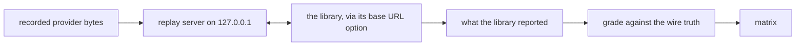

# wiretruth

wiretruth replays real LLM provider responses through LLM SDKs and checks whether each SDK reports what actually
happened.

**Does your LLM SDK tell you the truth?**

[](https://github.com/kartsan03/wiretruth/actions/workflows/ci.yml)
[](https://pypi.org/project/wiretruth/)
[](https://github.com/kartsan03/wiretruth/blob/main/LICENSE)

[](https://kartsan03.github.io/wiretruth/)

wiretruth tests any-llm, LiteLLM, pydantic-ai, the Vercel AI SDK, TanStack AI and the OpenAI Python SDK across six
APIs: OpenAI Chat Completions and Responses, Ollama's native and OpenAI-compatible endpoints, Gemini GenerateContent
and Anthropic Messages. That is 24 scenarios and 100 cells per library. pydantic-ai and the Vercel AI SDK support
only the OpenAI-compatible Ollama endpoint; their native Ollama cells are UNSUPPORTED. The OpenAI Python SDK speaks
only the two OpenAI APIs and Ollama's OpenAI-compatible endpoint, so its other cells are UNSUPPORTED.
The Anthropic responses are transcribed from Anthropic's documentation rather than recorded: each of those fixtures
is marked `documented` and links the page it comes from. More providers and libraries follow.
The [results matrix](https://kartsan03.github.io/wiretruth/) shows the grades from
[`results/`](https://github.com/kartsan03/wiretruth/tree/main/results).

## Why

A model hits its output token limit halfway through a JSON object. The provider says so plainly: the OpenAI
Responses API returns `"status": "incomplete"` with `"incomplete_details": {"reason": "max_output_tokens"}`. What
your code sees depends on the SDK in between. If the SDK raises a generic JSON parse error, nothing tells you that
a higher limit would fix it. If it returns the partial object as a success, your pipeline stores an incomplete
record.

wiretruth has this response recorded as `truncation.structured-output` on `openai-responses`. Every library gets
the same bytes:

| Library | What the caller gets | Grade |
|---|---|---|
| [LiteLLM](https://github.com/kartsan03/wiretruth/blob/main/results/litellm/1.110.2.json) | Returns the response with `incomplete_details.reason: "max_output_tokens"`, the cut-off JSON as text and the token usage, and parses none of it. | ✓ PASS |
| [pydantic-ai](https://github.com/kartsan03/wiretruth/blob/main/results/pydantic-ai/2.71.0.json) | Raises `OutputTokenLimitExceeded`, which names the token limit. The cut-off text and the usage are only in the messages that `capture_run_messages()` keeps. | ✓ PASS |
| [Vercel AI SDK](https://github.com/kartsan03/wiretruth/blob/main/results/vercel-ai/7.0.179.json) | Raises `NoObjectGeneratedError` with `finishReason: "length"` and the token usage. | ✓ PASS |
| [any-llm](https://github.com/kartsan03/wiretruth/blob/main/results/any-llm/1.53.1.json) | Raises pydantic's `ValidationError` ("Invalid JSON: EOF while parsing a string"), with no finish reason and no usage. | ~ LOSSY |
| [OpenAI Python SDK](https://github.com/kartsan03/wiretruth/blob/main/results/openai-python/3.57.0.json) | `responses.parse()` raises pydantic's `ValidationError` ("Invalid JSON: EOF while parsing a string"), with no finish reason and no usage. | ~ LOSSY |

The last two rows are one known bug: any-llm calls the OpenAI SDK's `responses.parse()`, which parses the text
without checking the response status ([openai/openai-python#2486](https://github.com/openai/openai-python/issues/2486),
open upstream).

The table is a snapshot: each library name links to the results file its row comes from, and the
[scenario page](https://kartsan03.github.io/wiretruth/scenarios/truncation.structured-output.html) shows the current
grades. TanStack AI isn't listed: its structured output streams on this API, so this non-streamed fixture is
UNSUPPORTED there.

wiretruth runs the same recorded edge cases through every library it supports and grades each one against what the
provider sent.

## What it checks

| Bug class | What goes wrong for users | Scenarios |
|---|---|---|
| Silent truncation | Agents accept partial output or retry without raising the limit | 6 |
| Finish reason mapping | Control flow branches on the wrong reason | 2 |
| Usage accounting | Cost and quota tracking is off (cached and reasoning tokens) | 3 |
| Stream integrity | Corrupted or unfinished text is treated as final | 4 |
| Tool call fidelity | Tools run with broken or merged arguments | 4 |
| Error classification | Retries and backoff misbehave | 1 |
| Request fidelity | The library sends fields the caller didn't set, or ones the model rejects | 4 |

The scenarios are in
[`suite/scenarios/`](https://github.com/kartsan03/wiretruth/tree/main/suite/scenarios), and the bug classes in
[`suite/bug-classes.json`](https://github.com/kartsan03/wiretruth/blob/main/suite/bug-classes.json).

## Grades

| | Grade | Meaning |
|---|---|---|
| ✓ | PASS | Reports what happened: meets every MUST requirement of the scenario. |
| ~ | LOSSY | Doesn't contradict what happened, but the fact is only in raw metadata, or missing. |
| ✗ | WRONG | Reports something that contradicts what happened. |
| ! | CRASH | Fails with an internal error, such as a `KeyError` in its own parser. |
| ⧗ | HANG | Doesn't return within 20 s on a response that ended within 1 s. |
| – | UNSUPPORTED | The library doesn't support this provider or feature (documented). |
| ? | HARNESS | A problem on our side, not the library's. |

Each scenario lists its requirements. MUST requirements set the grade. SHOULD requirements, such as the exact
partial text in the truncation scenarios, add a note when they aren't met. How grades are computed:
[docs/grading.md](https://github.com/kartsan03/wiretruth/blob/main/docs/grading.md).
Scenario catalog: [docs/scenarios.md](https://github.com/kartsan03/wiretruth/blob/main/docs/scenarios.md).
Fixed-bug validation: [docs/validation.md](https://github.com/kartsan03/wiretruth/blob/main/docs/validation.md).
Common questions: [docs/faq.md](https://github.com/kartsan03/wiretruth/blob/main/docs/faq.md).

## Quickstart

You need Python 3.11 or newer and [uv](https://docs.astral.sh/uv/), which builds each library's own environment.

```bash
git clone https://github.com/kartsan03/wiretruth && cd wiretruth
uv run wiretruth run --lib any-llm
uv run wiretruth run --lib litellm
uv run wiretruth run --lib pydantic-ai
uv run wiretruth run --lib vercel-ai
uv run wiretruth run --lib tanstack-ai
uv run wiretruth run --lib openai-python
uv run wiretruth site
```

The Vercel AI SDK and TanStack AI shims also need Node.js and npm. The runner builds their pinned dependencies
automatically; see [Shims](https://github.com/kartsan03/wiretruth/blob/main/shims/README.md) for supported providers and structured-output modes.

The any-llm run reports (see [`results/any-llm/1.40.2.json`](https://github.com/kartsan03/wiretruth/blob/main/results/any-llm/1.40.2.json)):

```text
scenario                                  anthropic      gemini   ollama   ollama-openai  openai-chat  openai-responses
finish.stop-sequence                      ✓ PASS         ✓ PASS   ✓ PASS   ✓ PASS
finish.unknown-value                      ✗ WRONG        ✗ WRONG  ✗ WRONG  ✓ PASS         ✓ PASS       ✓ PASS
request.max-tokens-field                                                                  ✓ PASS
request.max-tokens-ollama-openai                                           ✗ WRONG
request.no-injected-options                                       ✓ PASS
request.tools-with-reasoning-chat                                                         ✓ PASS
stream.error-midstream                    ✓ PASS         ✓ PASS   ✓ PASS                  ✓ PASS       ✓ PASS
stream.missing-finish                     ~ LOSSY        ~ LOSSY  ~ LOSSY  ~ LOSSY        ~ LOSSY      ✓ PASS
stream.missing-finish-abort               ✓ PASS         ✓ PASS   ✓ PASS   ✓ PASS         ✓ PASS       ✓ PASS
stream.utf8                               ✓ PASS         ✓ PASS   ✓ PASS   ✓ PASS         ✓ PASS       ✓ PASS
stream.utf8-split                         ✓ PASS         ✓ PASS   ✓ PASS   ✓ PASS         ✓ PASS       ✓ PASS
tools.parallel-calls                      ✓ PASS         ✓ PASS   ✗ WRONG  ✓ PASS         ✓ PASS       ✓ PASS
tools.parallel-calls-stream               ✓ PASS         ✓ PASS   ✗ WRONG  ✓ PASS         ✓ PASS       ✓ PASS
truncation.reasoning-only                 ✓ PASS         ✓ PASS   ✓ PASS   ✓ PASS         ✓ PASS       ✓ PASS
truncation.structured-output              ✓ PASS         ✓ PASS   ✓ PASS   ✓ PASS         ✓ PASS       ~ LOSSY
truncation.structured-output-forced-tool  – UNSUPPORTED
truncation.text                           ✓ PASS         ✓ PASS   ✓ PASS   ✓ PASS         ✓ PASS       ✓ PASS
truncation.text-stream                    ✓ PASS         ✓ PASS   ✓ PASS   ✓ PASS         ✓ PASS       ✓ PASS
truncation.text-stream-usage                             ✓ PASS                           ✓ PASS
truncation.tool-call-args                 ✓ PASS                                          ✓ PASS       ✓ PASS
truncation.tool-call-args-stream          ✓ PASS                                          ✓ PASS       ✓ PASS
usage.cached-tokens                       ✓ PASS                                          ✓ PASS       ✓ PASS
usage.reasoning-tokens                    ✓ PASS         ✓ PASS                           ✓ PASS       ✓ PASS
usage.stream-final-chunk                  ✓ PASS         ✓ PASS   ✓ PASS   ✓ PASS         ✓ PASS

finish.stop-sequence gemini
  shim: Gemini reasoning_effort none is unsupported by any-llm; omitted to use the model default.

finish.unknown-value anthropic
  MUST finish-is-other: CONTRADICTED: finish.value="stop" (primary: choices[0].finish_reason); truth.finish="other"; required finish="other"
  SHOULD raw-finish-reported: CONTRADICTED: finish.raw="stop"; truth.raw_finish="WIRETRUTH_UNKNOWN_REASON"

finish.unknown-value gemini
  MUST finish-is-other: CONTRADICTED: finish.value="stop" (primary: choices[0].finish_reason); truth.finish="other"; required finish="other"
  SHOULD raw-finish-reported: CONTRADICTED: finish.raw="stop"; truth.raw_finish="WIRETRUTH_UNKNOWN_REASON"
  shim: Gemini reasoning_effort none is unsupported by any-llm; omitted to use the model default.

finish.unknown-value ollama
  MUST finish-is-other: CONTRADICTED: finish.value="stop" (primary: choices[0].finish_reason); truth.finish="other"; required finish="other"
  SHOULD raw-finish-reported: CONTRADICTED: finish.raw="stop"; truth.raw_finish="wiretruth_unknown_reason"

request.max-tokens-ollama-openai ollama-openai
  MUST limit-field: CONTRADICTED: request[0].json_body.max_tokens=absent; required=16

stream.error-midstream gemini
  shim: Gemini reasoning_effort none is unsupported by any-llm; omitted to use the model default.

stream.missing-finish anthropic
  MUST stream-incomplete: NOT_OBSERVABLE: stream.completed=null; outcome=returned; truth.stream_completed=false

stream.missing-finish gemini
  MUST stream-incomplete: NOT_OBSERVABLE: stream.completed=null; outcome=returned; truth.stream_completed=false
  shim: Gemini reasoning_effort none is unsupported by any-llm; omitted to use the model default.

stream.missing-finish ollama
  MUST stream-incomplete: NOT_OBSERVABLE: stream.completed=null; outcome=returned; truth.stream_completed=false

stream.missing-finish ollama-openai
  MUST stream-incomplete: NOT_OBSERVABLE: stream.completed=null; outcome=returned; truth.stream_completed=false

stream.missing-finish openai-chat
  MUST stream-incomplete: NOT_OBSERVABLE: stream.completed=null; outcome=returned; truth.stream_completed=false

stream.missing-finish-abort gemini
  shim: Gemini reasoning_effort none is unsupported by any-llm; omitted to use the model default.

stream.utf8 gemini
  shim: Gemini reasoning_effort none is unsupported by any-llm; omitted to use the model default.

stream.utf8-split gemini
  shim: Gemini reasoning_effort none is unsupported by any-llm; omitted to use the model default.

tools.parallel-calls gemini
  shim: Gemini reasoning_effort none is unsupported by any-llm; omitted to use the model default.

tools.parallel-calls ollama
  MUST calls-reported: CONTRADICTED: tool_calls[0] id="81193cdc-7f88-4adc-8e6c-ac29f9b61b66", name="get_weather", args={"city": "São Paulo"}, parsed=true; truth id="call_9epwsqu6", name="get_weather", args={"city": "São Paulo"}, parsed=true; tool_calls[1] id="4e915b8d-84fe-4964-a833-09d08f617d15", name="get_weather", args={"city": "Zürich"}, parsed=true; truth id="call_bvzy1ra9", name="get_weather", args={"city": "Zürich"}, parsed=true

tools.parallel-calls-stream gemini
  shim: Gemini reasoning_effort none is unsupported by any-llm; omitted to use the model default.

tools.parallel-calls-stream ollama
  MUST calls-reported: CONTRADICTED: tool_calls[0] id="4e8b9dda-3fa3-4763-af44-dcab08600e3f", name="get_weather", args={"city": "São Paulo"}, parsed=true; truth id="call_8uaqob2r", name="get_weather", args={"city": "São Paulo"}, parsed=true; tool_calls[1] id="babaee2f-2591-4efd-bafd-5af506b87982", name="get_weather", args={"city": "Zürich"}, parsed=true; truth id="call_nyjtbrz4", name="get_weather", args={"city": "Zürich"}, parsed=true

truncation.structured-output gemini
  shim: Gemini reasoning_effort none is unsupported by any-llm; omitted to use the model default.

truncation.structured-output openai-responses
  MUST cause-is-truncation: NOT_OBSERVABLE: finish.value=null (absent); truth.finish="length"; error.category="validation"; structured.returned_as_success=false
  SHOULD text-reported: NOT_OBSERVABLE: text.value=null (absent); truth.text="{\"islands\":[{\"name\":\"Κρήτη\",\"sea\":\"Κρητικό Πέ"
  SHOULD usage-reported: NOT_OBSERVABLE: usage.input=null (absent); truth.usage.input=68; usage.output=null (absent); truth.usage.output=24

truncation.structured-output-forced-tool anthropic
  any-llm completion maps typed response_format to native output_config.format and has no structured parser for an explicitly forced tool. (https://github.com/mozilla-ai/any-llm/blob/1.40.2/src/any_llm/providers/anthropic/utils.py#L660-L686)

truncation.text gemini
  shim: Gemini reasoning_effort none is unsupported by any-llm; omitted to use the model default.

truncation.text-stream gemini
  shim: Gemini reasoning_effort none is unsupported by any-llm; omitted to use the model default.

truncation.text-stream-usage gemini
  shim: Gemini reasoning_effort none is unsupported by any-llm; omitted to use the model default.

usage.reasoning-tokens anthropic
  SHOULD reasoning-reported: NOT_OBSERVABLE: usage.reasoning=null (absent); truth.usage.reasoning=312

usage.stream-final-chunk gemini
  shim: Gemini reasoning_effort none is unsupported by any-llm; omitted to use the model default.

any-llm 1.40.2: 100 cells, 87 PASS, 6 LOSSY, 6 WRONG, 1 UNSUPPORTED
stderr: .wiretruth/runs/20261109T005301.682490Z
```

Every library's grades, with each cell's evidence, are in the [results matrix](https://kartsan03.github.io/wiretruth/),
rebuilt from `results/` on every push to `main`. A weekly workflow runs each library's latest releases and
proposes the new results as a pull request. TanStack AI's `chat()` always requests a streamed response, so the
non-streamed fixtures don't apply to it.

No API keys are needed. Everything runs against stored responses on `127.0.0.1`. The first run downloads the
selected library: a Python library into `.wiretruth/envs/`, a JavaScript library into `node_modules` next to its
shim. Later runs work offline. `uv run wiretruth run --shim shims/reference` runs the built-in reference client,
which must pass every cell. The scenarios, fixtures and shims live in this repository, so wiretruth runs from a
clone.

Releases are also on [PyPI](https://pypi.org/project/wiretruth/) (`pip install wiretruth`). The package is the
command only, so run it inside a checkout of the matching release tag (for example `v0.5.0`); on `main`, use
`uv run` as above.

## Reproduce a cell without wiretruth

Every cell can be reproduced with plain library code. `wiretruth serve` serves one fixture on `127.0.0.1`:

```bash
uv run wiretruth serve openai-responses/truncation.structured-output --port 8765
```

```text
wiretruth serve: openai-responses/truncation.structured-output on http://127.0.0.1:8765
openai-responses base URL: http://127.0.0.1:8765/v1
Press Ctrl-C to stop.
```

In another terminal, call it the way you normally would. With the OpenAI Python SDK (`pip install openai`):

```python
from openai import OpenAI
from pydantic import BaseModel


class Island(BaseModel):
    name: str
    sea: str


class Islands(BaseModel):
    islands: list[Island]


client = OpenAI(base_url="http://127.0.0.1:8765/v1", api_key="unused")
client.responses.parse(model="gpt-6-luna", input="List ten Greek islands.", text_format=Islands)
```

```text
Traceback (most recent call last):
  ...
pydantic_core._pydantic_core.ValidationError: 1 validation error for Islands
  Invalid JSON: EOF while parsing a string at line 1 column 59 [type=json_invalid, input_value='{"islands":[{"name":"Κ...a":"Κρητικό Πέ', input_type=str]
```

The error doesn't say that the response stopped at `max_output_tokens`. The server answers every request to that
path with the recorded response, so the prompt and the model don't change what comes back.

## Add your library

A shim is a small program. It reads a call spec as JSON on stdin, calls your library the way its docs show, and
prints what the library reported as JSON on stdout. The
[shims in this repository](https://github.com/kartsan03/wiretruth/tree/main/shims) are examples. The steps are in
[Writing a shim](https://github.com/kartsan03/wiretruth/blob/main/docs/writing-a-shim.md); to propose a library,
[open a new-library issue](https://github.com/kartsan03/wiretruth/issues/new?template=new-library.yml).

## How it works



- **Fixtures** are provider HTTP responses stored with their provenance: for a recorded one, when, which model and
  which CI run. Stream events are kept as sent; JSON bodies are parsed and written back in the same key order.
- **Truth** is computed from the wire by a small parser for each provider API, with no SDK involved.
- **Shims** call each library the way its documentation shows, with default settings, and report only what its
  public API exposes. A setting a fixture needs is declared in the shim's manifest.
- **Checks** compare what the library reported with the truth. **Grades** fold the checks into one verdict per cell.
- **Self-tests:** a reference client must pass every cell, and a deliberately wrong client must fail in known ways.

## Fixture provenance

- **Recorded:** real provider responses, recorded by a
  [manual CI workflow](https://github.com/kartsan03/wiretruth/blob/main/.github/workflows/record.yml) whose runs
  are public. Each fixture links its run.
- **Documented:** transcribed from official API docs when there is no key for that provider (Anthropic today).
  Each fixture links its source page.
- **Derived:** a recorded or documented response with one deterministic change, such as a stream that stops before
  its finish event, for cases a provider can't be made to produce on demand. Each fixture gives the reason and
  evidence that the shape happens.

Every cell shows its tier. By default, re-recording keeps the old fixture in the suite as a dated file. Details:
[docs/recording.md](https://github.com/kartsan03/wiretruth/blob/main/docs/recording.md) and
[docs/derived-fixtures.md](https://github.com/kartsan03/wiretruth/blob/main/docs/derived-fixtures.md).

## Disclosure and upstream fixes

A cell turns WRONG, CRASH or HANG on `main` only after the finding is on record upstream: an issue this project
opened, an existing issue it links to, or the library's own documentation of the behavior. When a fix ships, the weekly run picks up the release, and the changelog's
Results section names the fix. Every report and its status is in
[`results/upstream.json`](https://github.com/kartsan03/wiretruth/blob/main/results/upstream.json), and each cell
page on the site shows the reports for that cell. The policy:
[docs/disclosure.md](https://github.com/kartsan03/wiretruth/blob/main/docs/disclosure.md).

## Related work

- [Open Responses](https://github.com/openresponses/openresponses): a spec and compliance tests for servers that
  implement the Responses API. wiretruth tests clients across several native APIs.
- [LLMConform](https://github.com/aitk-org/LLMConform): conformance tests for LLM gateways and APIs, run live.
- [llmprobe](https://github.com/ivanfioravanti/llmprobe) and [conform](https://github.com/NiLabs-Org/conform):
  conformance for inference engines (vLLM, llama.cpp, Ollama, …).
- [aimock](https://github.com/CopilotKit/aimock): a mock server for testing AI apps, with record and replay. Use it
  for your app's tests; wiretruth audits the SDK layer itself.
- [spantruth](https://github.com/Plexito-de/spantruth): a separate project, called wiretruth until 2026-10-12.
  It replays provider responses through LLM instrumentation libraries (OpenLLMetry, OpenInference, the OpenTelemetry
  GenAI instrumentation) and checks what they write on spans. Use it for your traces; wiretruth checks what the SDK
  returns to the caller.
- The design borrows from [JSONTestSuite](https://github.com/nst/JSONTestSuite),
  [Wycheproof](https://github.com/C2SP/wycheproof), [toml-test](https://github.com/toml-lang/toml-test) and
  [compat-table](https://github.com/compat-table/compat-table).

## Author note

I've contributed fixes to libraries that wiretruth tests or will test:
[mozilla-ai/any-llm#1389](https://github.com/mozilla-ai/any-llm/pull/1389),
[mozilla-ai/any-llm#1433](https://github.com/mozilla-ai/any-llm/pull/1433) and
[TanStack/ai#1548](https://github.com/TanStack/ai/pull/1548). Grades are computed by the code in this repository.
If you think a grade is wrong, please
[open a grade dispute](https://github.com/kartsan03/wiretruth/issues/new?template=grade-dispute.yml).

## Contributing

Scenario ideas, new libraries and grade disputes are all welcome. See
[CONTRIBUTING.md](https://github.com/kartsan03/wiretruth/blob/main/CONTRIBUTING.md).

## Citing

See [CITATION.cff](https://github.com/kartsan03/wiretruth/blob/main/CITATION.cff).

## License

MIT. Fixtures contain model outputs recorded from provider APIs;
[docs/recording.md](https://github.com/kartsan03/wiretruth/blob/main/docs/recording.md) explains how they're recorded.
