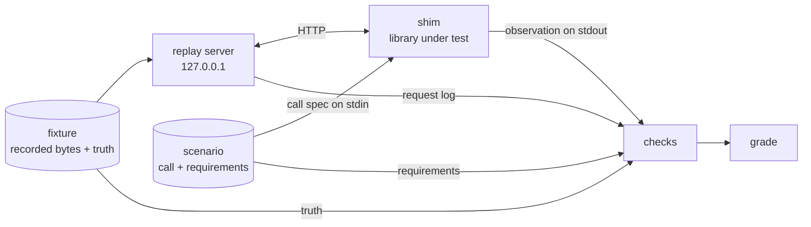

# Concepts

This page is for anyone new to wiretruth. After reading it, you should be able to explain how a provider response
becomes a grade for a library, and what each grade means.

wiretruth is still being built. This page describes the design that the code implements as it lands. The reasoning
behind each design choice is in the [decision records](index.md#decisions).

## The short version

wiretruth replays real provider responses through LLM SDKs and checks whether each SDK reports what actually
happened.

1. A provider response is saved byte for byte, together with what it means: why the model stopped, how many tokens
   it used, what text and tool calls it returned.
2. A small local server replays those bytes. The library under test is pointed at that server through its normal
   base URL option, so it runs its real HTTP and parsing code.
3. A small adapter program calls the library the way its documentation shows and writes down what the library
   reported.
4. Checks compare the library's report with what the provider actually sent, and the result is a grade.

No API keys are needed to run the suite. Recording new responses is a separate step. Most fixtures are recorded
from the real APIs; the rest are transcribed from official documentation or derived from other fixtures, and every
result says which.

## How one cell runs



## Terms

**Provider.** One wire format of one LLM API, for example `openai-chat` (Chat Completions), `openai-responses`,
`anthropic`, `gemini` or `ollama`. The same company can have more than one provider id when it has more than one
API.

**Scenario.** One edge case, written once for all providers. A scenario has a provider-neutral `call` (messages,
token limit, stream or not, output schema, tools) and a list of requirements. Each requirement is a MUST or SHOULD
statement backed by a named check. Example: `truncation.structured-output`, "Structured output cut off by the
output token limit".

**Fixture.** What one provider sent for one scenario. It holds the HTTP exchanges (status, the allowed headers, and the
body as JSON, server-sent events, NDJSON lines, plain text or raw byte chunks), where the response came from, and
the truth. Stream events are kept exactly as sent. JSON bodies are kept as parsed JSON, and raw byte chunks are
used where exact bytes matter. Fixtures come in three tiers, shown on every result:

- **recorded**: sent by the real API and saved by the recorder, with the model, the time and, when it was
  recorded in CI, the run;
- **documented**: transcribed from the provider's official documentation, with the source link;
- **derived**: another fixture changed by a named fault-injection transform, for example "cut the stream after
  five events", with the reason and evidence that the shape happens in practice.

**Truth.** What the provider actually said, in one canonical vocabulary: the finish reason (`stop`, `length`,
`tool_calls`, `content_filter`, `refusal`, `error`, `other` or `none`), the raw provider value, the text, the tool
calls, the usage, any error, and whether the stream completed. A small reference parser per provider computes the
truth from the wire. `wiretruth lint` recomputes it for every fixture, so the stored truth can't drift from the
bytes.

**Shim.** A small program that adapts one library to the suite. It reads a call spec, calls the library the way the
library's documentation shows, with default settings, and prints an observation. A shim never repairs or
post-processes the library's output. It can be written in any language.

**Call spec.** The JSON the runner sends to a shim on stdin: the scenario's call, plus the provider and the model.

**Observation.** The JSON a shim prints on stdout: what the library reported. That covers whether the call returned
or raised, the finish reason, text, structured output, tool calls, usage and stream state. For each value, the
observation also records where the library exposed it.

**Surface.** Where a value was found:

- **primary**: a documented, typed field of the main result, such as `response.choices[0].finish_reason`;
- **raw**: provider metadata or the raw payload, which most callers never look at;
- **absent**: not exposed anywhere the public API reaches.

**Check.** A named function that compares one requirement with the observation and the truth. It returns one of
three statuses, with a short evidence string:

- **SATISFIED**: the observation meets the requirement;
- **CONTRADICTED**: the observation contradicts the truth;
- **NOT_OBSERVABLE**: the observation neither meets nor contradicts it. For example, the fact is only in raw
  metadata, or the library raised an error that doesn't name the cause.

**Cell.** One library at one version, one scenario, one provider. The cell is the unit of the results: it carries
the grade, the status of every requirement, the full observation and the fixture tier.

**Grade.** The result for one cell:

| Grade | Meaning |
|---|---|
| PASS | Reports what happened. |
| LOSSY | Doesn't contradict what happened, but you only find it in raw metadata, or not at all. |
| WRONG | Reports something that contradicts what happened. |
| CRASH | Throws an unexpected internal error on a valid provider response. |
| HANG | Doesn't return after receiving a response that ended right away. |
| UNSUPPORTED | The library doesn't support this provider or feature, according to its documentation. |
| HARNESS | Our problem, not the library's. |

The grade comes from the first rule that applies:

1. The time limit ran out: HANG if the library had received the whole response, otherwise HARNESS.
2. The shim's process ended without an observation: CRASH if it was killed by a signal after the response was
   served, otherwise HARNESS.
3. The observation is invalid, or the library called a different endpoint or stream mode than the fixture serves:
   HARNESS.
4. The shim reports, with a documentation link, that the library can't express the call: UNSUPPORTED.
5. The library raised a language builtin from its own code (`IndexError`, `KeyError`, `TypeError`, …): CRASH.
6. A MUST requirement is CONTRADICTED: WRONG.
7. A MUST requirement is NOT_OBSERVABLE: LOSSY.
8. Otherwise: PASS.

SHOULD requirements never change the grade. When one isn't met, the cell gets a note.

## A worked example: structured output cut off by the token limit

The scenario `truncation.structured-output` asks for a list of ten Ukrainian cities as JSON matching a schema, with
`max_output_tokens: 24`. Twenty-four tokens aren't enough, so the model stops halfway through the object. The call
also turns reasoning off: current models reason by default, and a small token limit would otherwise be spent on
reasoning before any JSON appears.

The JSON on this page is shortened and illustrative. Real fixtures live in `suite/fixtures/`.

### 1. The scenario

```json
{
  "id": "truncation.structured-output",
  "bug_class": "silent-truncation",
  "call": {
    "stream": false,
    "max_output_tokens": 24,
    "reasoning": {"effort": "none"},
    "messages": [{"role": "user", "content": "List ten large Ukrainian cities as JSON: …"}],
    "output_schema": {"type": "object", "properties": {"cities": {"type": "array", "…": "…"}}, "required": ["cities"]}
  },
  "requirements": [
    {"id": "no-partial-success", "level": "MUST", "check": "no_success_structured_value",
     "text": "A partial object is never returned as a successful result."},
    {"id": "cause-is-truncation", "level": "MUST", "check": "truncation_is_signalled",
     "text": "The caller can tell that the output stopped at the token limit."},
    {"id": "usage-reported", "level": "SHOULD", "check": "usage_matches_truth", "args": {"fields": ["input", "output"]},
     "text": "Token usage is reported even though the result is unusable."}
  ]
}
```

### 2. The fixture

For `openai-chat`, the recorder turns the neutral call into a native Chat Completions request with a JSON schema
response format and saves the response. The provider's reference parser computes the truth from it. A recorded
fixture for this scenario looks like this:

```json
{
  "id": "openai-chat/truncation.structured-output",
  "tier": "recorded",
  "exchanges": [{
    "match": {"method": "POST", "path": "/v1/chat/completions"},
    "response": {"status": 200, "body": {"json": {
      "choices": [{"index": 0, "finish_reason": "length",
                   "message": {"role": "assistant", "content": "{\"cities\":[{\"name\":\"Kyiv\",\"oblast\":\"Ky"}}],
      "usage": {"…": "…"}
    }}}
  }],
  "truth": {"finish": "length", "raw_finish": "length", "text": "{\"cities\":[{\"name\":\"Kyiv\",\"oblast\":\"Ky",
            "structured": null, "error": null, "usage": {"…": "…"}}
}
```

The truth says that the model stopped because of the token limit (`length`) and that the text isn't a complete
JSON object.

### 3. The run

The runner starts the replay server with this fixture on a free local port. It starts the shim with the server's
URL in `WIRETRUTH_BASE_URL_OPENAI_CHAT` and the call spec on stdin. The library sends its request to the local
server, which answers with the recorded bytes. The library parses them, and the shim prints what the library
reported.

### 4. Observations and grades

Here are four ways a library could report this response, and how each one grades. Libraries A to D are
hypothetical.

**Library A** raises an error that says the output hit the token limit:

```json
{"outcome": "raised",
 "error": {"type": "a.OutputTruncatedError", "category": "truncation", "message": "…"},
 "structured": {"attempted": true, "returned_as_success": false, "value": null}}
```

`no-partial-success` is SATISFIED and `cause-is-truncation` is SATISFIED. Grade: **PASS**. If the error doesn't
carry usage, the cell gets a note for the SHOULD requirement, and the grade stays PASS.

**Library B** raises a generic JSON parse error:

```json
{"outcome": "raised",
 "error": {"type": "b.JSONDecodeError", "category": "parse", "message": "Unterminated string …"},
 "structured": {"attempted": true, "returned_as_success": false, "value": null}}
```

`no-partial-success` is SATISFIED, because nothing partial came back as success. `cause-is-truncation` is
NOT_OBSERVABLE: the call failed loudly, but the caller can't tell that raising the limit would fix it. Grade:
**LOSSY**.

**Library C** repairs the partial JSON and returns it as a success:

```json
{"outcome": "returned",
 "finish": {"value": "stop", "raw": "length", "surface": "primary", "source": "result.finish_reason"},
 "structured": {"attempted": true, "returned_as_success": true, "value": {"cities": [{"name": "Kyiv", "oblast": "Ky"}]}}}
```

`no-partial-success` is CONTRADICTED: one incomplete record came back as if it were the whole answer.
`cause-is-truncation` is CONTRADICTED too, because the main result says the model stopped normally. Grade:
**WRONG**. Each check leaves an evidence string that says what it saw, for example
`finish.value="stop" (primary: result.finish_reason) but truth.finish="length"`.

**Library D** raises `KeyError` from inside its own response parser. Grade: **CRASH**, whatever the requirements
say, because the library failed on a valid provider response.

## What to read next

- [The decision records](index.md#decisions), for why replay, shims, JSON data, grades, fixture tiers and default
  configuration work the way they do.
- [The docs map](index.md).
